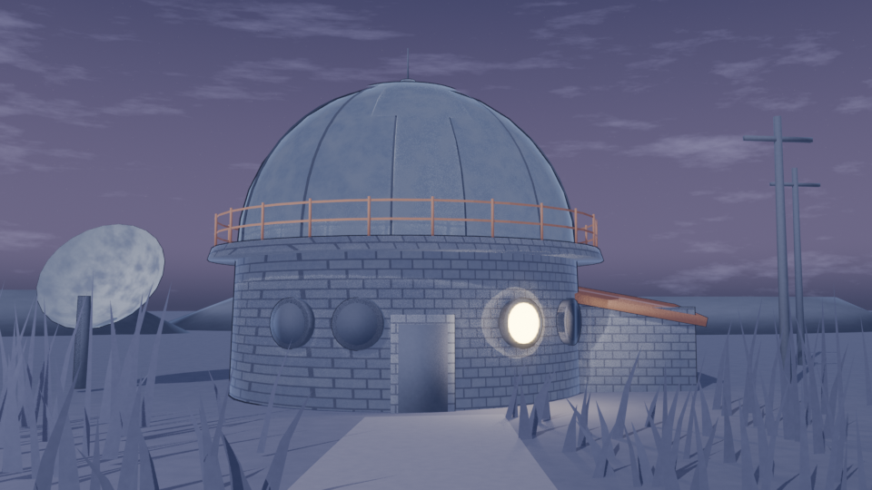
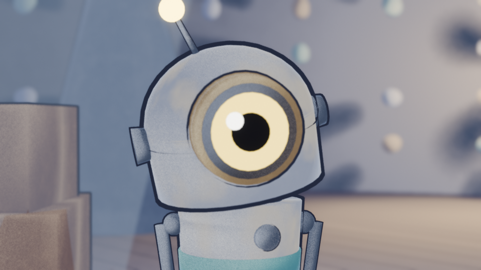
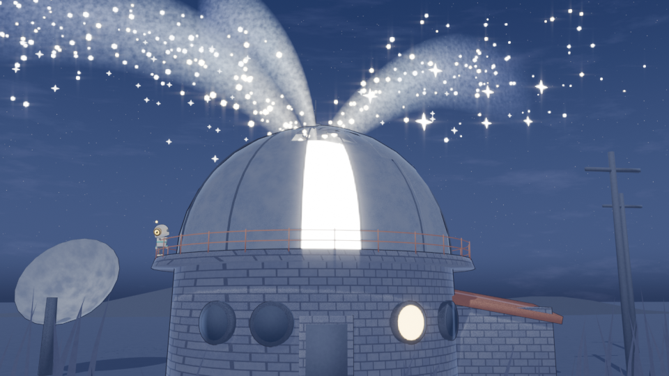
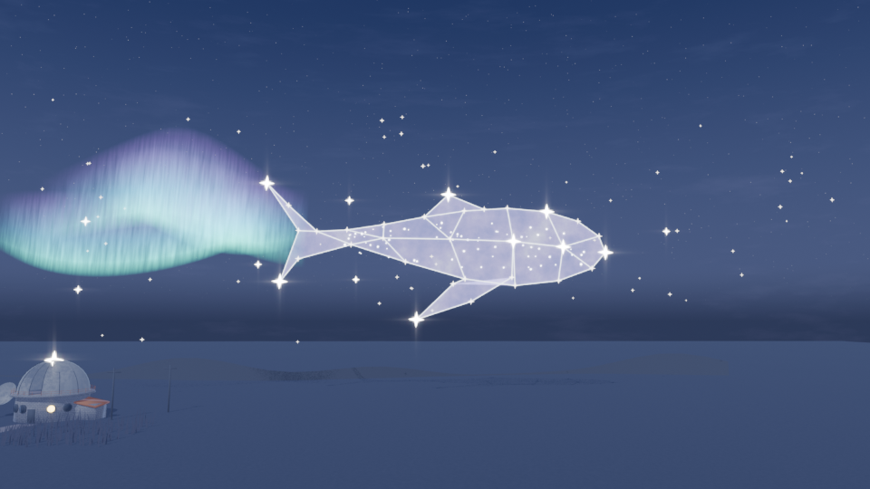

# 最后一颗星 · The Last Star

一款以 **手绘绘本风 2.5D NPR（法式水粉/赛璐璐绘本 + 墨线描边）** 打造的 59 秒纯 Python + Blender 5.2 程序化动画短片，并附带可直接在线游玩的 **HTML5 Canvas 交互式绘本小游戏**。

> **在线试玩（GitHub Pages，打开浏览器即玩）**：https://n0tanti.github.io/the-last-star/  
> **高清 59 秒中文版成片下载（Releases）**：https://github.com/N0tANTi/the-last-star/releases/latest

---

## 画面预览

| 暮色天文台 | 室内星象仪与单眼机器人 |
| :---: | :---: |
|  |  |

| 银河星流喷涌 | 星座星鲸与三层极光 |
| :---: | :---: |
|  |  |

| 走廊接住最后一颗星 | 中文手写片尾 |
| :---: | :---: |
|  |  |

---

## 在线试玩玩法（`docs/index.html`）

直接访问 [在线试玩页面](https://n0tanti.github.io/the-last-star/) 或本地双击打开 `docs/index.html`（零依赖、无需安装任何插件，自带 Web Audio 实时竖琴/钢片琴配乐）：

1. **第一幕 · 暮色天文台**：用 `A / D`、`← / →` 或直接点击画面控制提灯小机器人，点亮圆形暖窗并推门而入。
2. **第二幕 · 唤醒星象仪**：点击或按空格逐一点亮双球星象仪上的 7 枚黄铜星辰镜头，伴随渐高竖琴音符滑开穹顶天窗。
3. **第三幕 · 连线星鲸与极光**：依次点击或划过夜空中闪烁的星座光点，亲手连出巨型星云座头鲸并唤醒三层极光。
4. **第四幕 · 接住最后一颗星 & 自由观星**：在天文台石廊上接住飘落的金色星光，随后可在夜空中自由挥洒星尘。

---

## 本地从 Python 源码渲染 59 秒高清短片

需安装 **Blender 5.2**（自带 Python 与 FFmpeg 合成，无需额外依赖）：

```powershell
# 1. 快速渲染全部 10 个分镜关键帧预览
.\render.ps1 -Mode preview -Width 960 -Height 540 -Samples 16

# 2. 渲染完整 59 秒 1280x720 24fps 动画短片（含 NumPy 合成的立体声配乐）
.\render.ps1 -Mode render -Width 1280 -Height 720 -Samples 12
```

## 项目结构

```text
the-last-star/
├── docs/
│   ├── index.html          # GitHub Pages 在线试玩版（手绘绘本风四幕交互小游戏）
│   └── screenshots/        # README 展示图
├── render.ps1              # 一键预览 / 渲染 / 音视频合成脚本
└── src/
    ├── npr.py              # 手绘水粉 NPR 着色器（ShaderToRGB + 墨线描边 + 合成器星芒）
    ├── robot.py            # 单眼圆头小机器人与提灯建模及动画
    ├── observatory.py      # 天文台外景/内景、双球蔡司星象仪建模
    ├── fx.py               # 银河星尘涡流、30 点平滑座头星鲸 + 三层极光、中文手写片尾
    ├── shots.py            # 全片 10 个分镜编排（00:00–00:59 @ 24fps = 1,416 帧）
    ├── sound.py            # 纯 NumPy 合成 59 秒立体声配乐与音效
    └── pipeline.py         # Blender 预览、分镜渲染与 VSE 自动封装成 MP4
```
